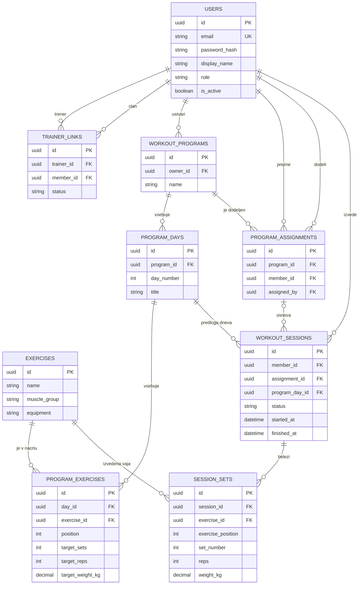

# GymTracker – podatkovni model

## Izbrana podatkovna baza
Uporabljena bo **PostgreSQL**, relacijska podatkovna baza. Primarni ključi so UUID, datumi in časi so shranjeni kot `timestamptz`, masa pa kot `numeric(6,2)` v kilogramih. Polja `created_at` so predvidena pri vseh glavnih entitetah.

## Entitete in glavna polja

| Entiteta | Glavna polja | Namen |
|---|---|---|
| `users` | `id` PK, `email` UNIQUE, `password_hash`, `display_name`, `role` (`MEMBER`/`TRAINER`/`ADMIN`), `is_active`, `created_at` | Uporabniki in vloge |
| `trainer_links` | `id` PK, `trainer_id` FK → users, `member_id` FK → users, `status` (`PENDING`/`ACCEPTED`/`REJECTED`/`REVOKED`), `created_at` | Povabilo in soglasje za sodelovanje |
| `exercises` | `id` PK, `name`, `muscle_group`, `equipment`, `is_active` | Globalni katalog vaj |
| `workout_programs` | `id` PK, `owner_id` FK → users, `name`, `description`, `created_at` | Predloga programa, ki jo ustvari član ali trener |
| `program_days` | `id` PK, `program_id` FK → workout_programs, `day_number`, `title` | Dnevi znotraj programa |
| `program_exercises` | `id` PK, `day_id` FK → program_days, `exercise_id` FK → exercises, `position`, `target_sets`, `target_reps`, `target_weight_kg` NULL | Načrtovane vaje v posameznem dnevu |
| `program_assignments` | `id` PK, `program_id` FK → workout_programs, `member_id` FK → users, `assigned_by` FK → users, `assigned_at` | Dodelitve programov članom |
| `workout_sessions` | `id` PK, `member_id` FK → users, `assignment_id` FK → program_assignments NULL, `program_day_id` FK → program_days, `status` (`IN_PROGRESS`/`COMPLETED`), `started_at`, `finished_at` NULL, `notes` | Posamezen izveden trening |
| `session_sets` | `id` PK, `session_id` FK → workout_sessions, `exercise_id` FK → exercises, `exercise_position`, `set_number`, `reps`, `weight_kg` NULL | Dejanske serije, ki jih je član izvedel |

## Povezave in omejitve
- Uporabnik ustvari več programov; vsak program ima več dni, dan pa več načrtovanih vaj.
- Kataloška vaja se lahko pojavi v več programih in v več izvedenih serijah.
- Trener in član sta povezana prek `trainer_links`; povezava mora imeti status `ACCEPTED` za dodelitve in trenerjev vpogled.
- Program ima lahko več dodelitev, posamezna dodelitev pripada enemu članu.
- Član ima več izvedenih treningov; vsak trening ima več dejanskih serij.
- `workout_sessions` hrani referenco na izvorni dan in dodelitev, `session_sets` pa lastno kopijo izvedenih vrednosti. Spremembe načrta zato ne prepišejo zgodovine.
- Za samostojni program člana se ob zagonu ustvari dodelitev z `assigned_by = member_id`; za trenerjev program mora biti `assigned_by` trener z aktivno povezavo do člana.
- Omejitve: `users.email` UNIQUE; `program_days(program_id, day_number)` UNIQUE; `program_exercises(day_id, position)` UNIQUE; `session_sets(session_id, exercise_position, set_number)` UNIQUE; `target_sets > 0`, `target_reps > 0`, `reps > 0`, `weight_kg >= 0` (če ni NULL); trener in član v povezavi ne smeta biti ista oseba.
- `session_sets.exercise_position` ohrani položaj vaje ob beleženju; dovoljene so tudi večkratne pojavitve iste vaje v posameznem treningu.

## Osnutek ER-diagrama

## Podatkovna pravila v aplikaciji
Vloga uporabnika (`role`) in povezava s trenerjem se preverjata v backendu, ne le v uporabniškem vmesniku. Ob deaktivaciji vaje ostane njen zapis zaradi obstoječih programov in zgodovine. Ob preklicu sodelovanja ostanejo treningi v bazi in so vidni članu, trener pa izgubi dostop. Preverjanje, da dan pripada programu v izbrani dodelitvi in da dodelitev pripada trenutnemu članu, se izvede pred začetkom treninga.

Za MVP se spreminjanje že uporabljenih programov poenostavi: obstoječi zaključeni treningi ostanejo nespremenjeni; priporočljivo je urejati program med treningi, saj aktivna izvedba uporablja podatke, s katerimi je bila začeta.
