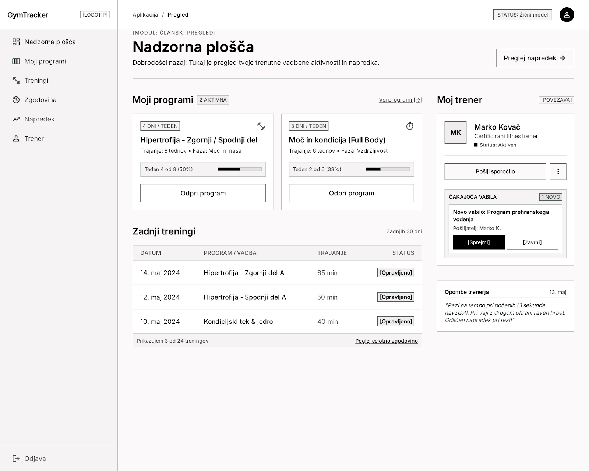
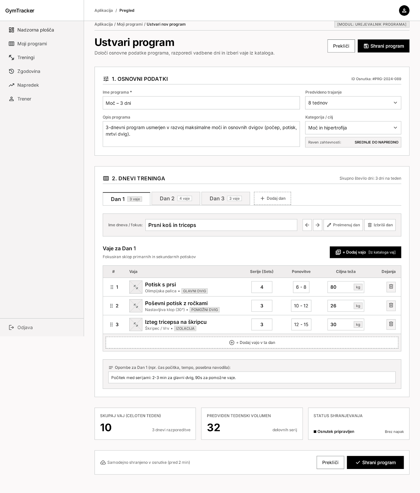
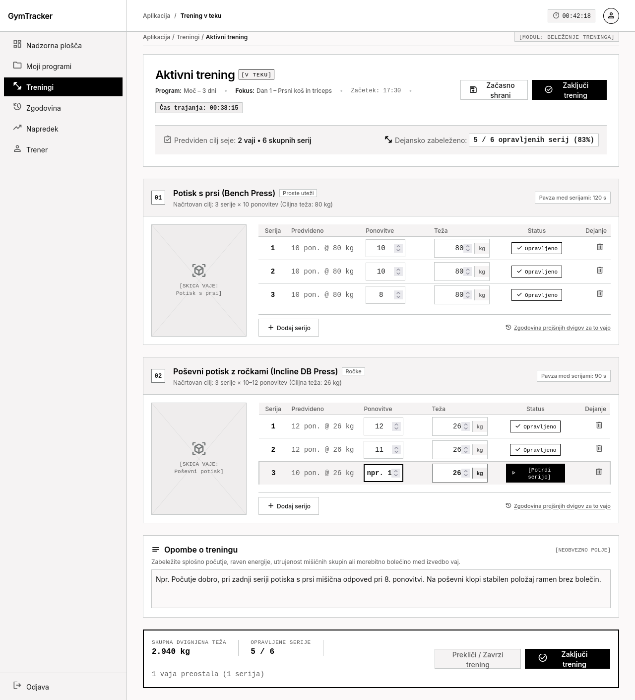
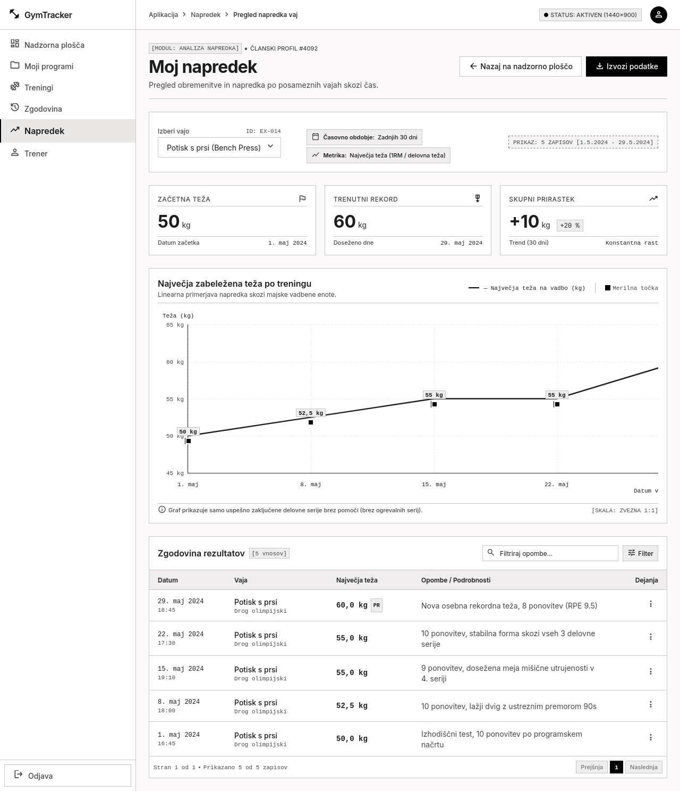

# GymTracker – Wireframes

## 1. Nadzorna plošča

Prikazuje uporabnikove programe, zadnje treninge in navigacijo po aplikaciji.

## 2. Ustvarjanje programa

Prikazuje dodajanje dni, vaj ter ciljnih serij, ponovitev in teže.

## 3. Izvajanje treninga

Prikazuje vnos izvedenih serij, ponovitev in teže ter zaključek treninga.

## 4. Pregled napredka

Prikazuje graf največje zabeležene teže za izbrano vajo in zgodovino rezultatov.
